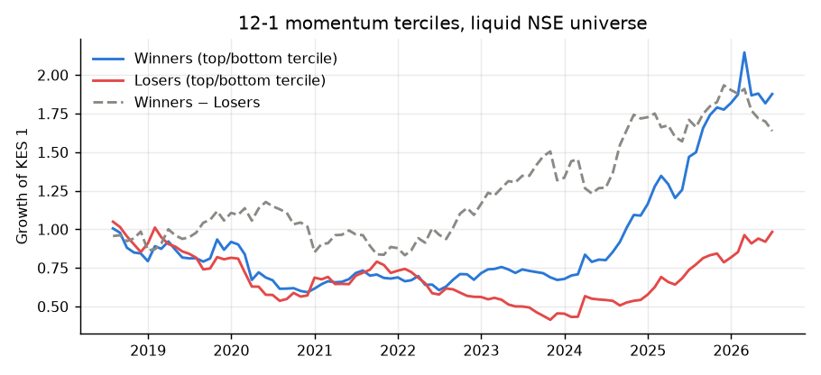
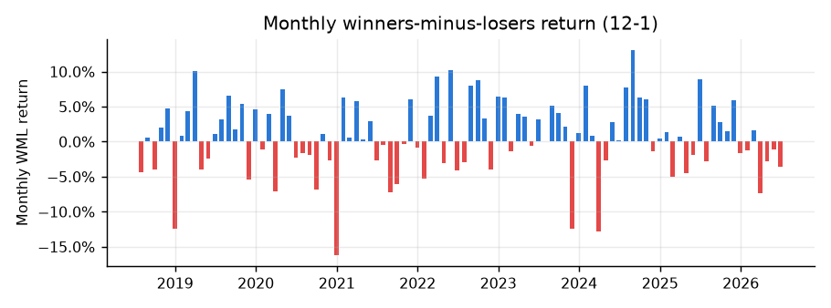

# Does Momentum Work on the Nairobi Securities Exchange?

*NSE Quant research note · generated 28 September 2026 from daily prices Jul 2018–Jun 2026*

## Abstract

We test the cross-sectional momentum effect of Jegadeesh & Titman (1993) on NSE-listed equities.
Each month we rank liquid stocks by their past 12-month return, skipping the most recent month, and
hold an equal-weighted portfolio of the top tercile against the bottom tercile. Over
96 months the winners-minus-losers (WML) portfolio earned **0.66% per month**
(8.2% annualised) with a Newey–West t-statistic of **1.23** — positive but not statistically significant.
The shortest horizon is the strongest pattern in the data. Last month's losers beat last month's winners by
0.88% a month (Newey–West t = -2.57),
consistent with stale prices and bid–ask bounce. Our reading is that the NSE shows at most a weak intermediate-horizon momentum
premium. Too few stocks trade, and the history is too short, to distinguish it from zero with confidence.

## 1. Data and universe

Daily closing prices, volumes and net foreign flows for 67 NSE securities come from a broker
export. The export is noisy. The cleaning pipeline (`nsequant.data.clean_prices`) drops scrambled export days, blanks out
one-day price spikes that revert, and leaves out of returns any unexplained single-day move above 30%. That last rule
matters because the NSE caps most daily moves at ±10%, so a larger move is an error or a corporate action. Every correction is
listed on the dashboard's Data Quality page.

Momentum is only tradable where prices are real. Each month the universe is restricted to stocks with at least KES 1 million
of average daily traded value over the past quarter that also traded on at least half of those days. ETFs and REITs are excluded.
The universe holds a median of **19 stocks** (range 11–32), so
we use terciles rather than the deciles common in US studies.

## 2. Method

At each month-end *t* the signal is the return from *t−12* to *t−1*, skipping month *t* to avoid the short-term reversal effect.
Stocks are sorted into terciles on the signal. The next month's return is measured for the equal-weighted top (Winners) and
bottom (Losers) groups. WML is their difference. Standard errors use Newey–West with six lags, to allow for the
serial correlation that overlapping formation windows and stale prices create.

## 3. Results

| Formation | Months | Mean WML / month | Annualised | t (OLS) | t (Newey–West) | Hit rate |
|---|---|---|---|---|---|---|
| 12-1 | 96 | 0.66% | 8.2% | 1.20 | 1.23 | 57% |
| 6-1 | 102 | 0.28% | 3.4% | 0.52 | 0.52 | 51% |
| 3-1 | 105 | -0.08% | -0.9% | -0.16 | -0.21 | 50% |
| 12-0 (no skip) | 96 | 0.01% | 0.2% | 0.02 | 0.03 | 54% |
| 1-0 (reversal) | 107 | -0.88% | -10.0% | -1.95 | -2.57 | 42% |

The 12-1 WML portfolio has a CAPM beta of **-0.06** against the liquidity-weighted market proxy and a monthly
alpha of **0.71%** (t = 1.28). The winner leg replaces about **28%** of its names each month.

### Robustness: sub-periods

| Period | Months | Mean / month | t (Newey–West) |
|---|---|---|---|
| 2018–2021 | 42 | -0.17% | -0.25 |
| 2022–2026 | 54 | 1.30% | 1.84 |

## 4. Discussion

* **Statistical power is the binding constraint.** With about twenty names per month, each tercile holds six or seven stocks,
  so idiosyncratic noise dominates. At the observed WML volatility of 5.4% a month, a true premium of 1% a
  month would need about 10 years of data to reach t = 2.
* **Short-horizon reversal.** The 1-0 row shows how last month's return predicts the next one. On the NSE, bid–ask bounce and
  stale prices push this towards reversal, which is why the skip month matters.
* **Implementability.** Short-selling is not practically available on the NSE, so the long-only Winners leg is the relevant
  portfolio for a local investor. At the observed turnover, round-trip costs of roughly 2–3% (brokerage, levies and spread
  on illiquid names) would absorb much of any premium.
* **Survivorship.** The export includes suspended and delisted counters (e.g. Mumias, ARM Cement, Uchumi), so the universe
  is not survivorship-filtered. Their stale prices are excluded by the liquidity screen, not dropped from the sample.

## 5. Conclusion

Momentum on the NSE is positive but not statistically significant over this sample. The evidence is not strong enough to trade on without
further out-of-sample data, and costs are likely to consume much of the gross premium. Extending the sample back before 2017 and
adding weekly-rebalanced variants are the obvious next steps.

## References

* Jegadeesh, N. & Titman, S. (1993). Returns to buying winners and selling losers. *Journal of Finance*, 48(1).
* Asness, C., Moskowitz, T. & Pedersen, L. (2013). Value and momentum everywhere. *Journal of Finance*, 68(3).
* Newey, W. & West, K. (1987). A simple, positive semi-definite, heteroskedasticity and autocorrelation consistent covariance matrix. *Econometrica*, 55(3).

*For research and education only; not investment advice.*
