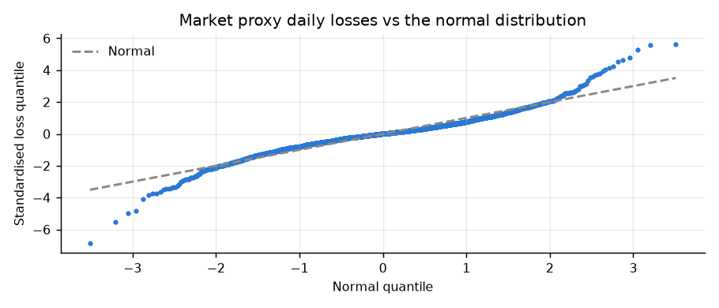
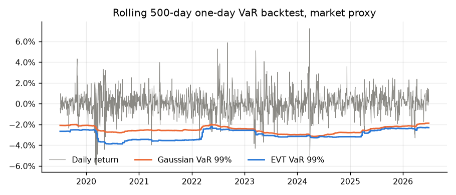

# Estimating Tail Risk in Kenyan Equity Portfolios Using Extreme-Value Methods

*NSE Quant research note · generated 28 September 2026 from daily prices Jun 2017–Jun 2026*

## Abstract

Kenyan equity returns are strongly non-normal. Daily losses on a liquidity-weighted NSE market proxy have excess kurtosis of
**4.9**. A Generalised Pareto fit to the loss tail gives a shape parameter ξ = **0.21**,
which implies a heavy, power-law tail. At the 99% level, extreme-value (EVT) expected shortfall exceeds the Gaussian estimate
by **47%**. In a rolling out-of-sample backtest the Gaussian 99% VaR is breached on 1.84% of days
(Kupiec p = 0.002). EVT and historical simulation breach on 1.56% and
1.50% of days respectively.

## 1. Data

The market proxy is built from daily constituent returns weighted by trailing 60-day traded value, because the export carries no
NASI series. The second series is an equal-weighted portfolio of the 23 stocks that passed the liquidity screen in most
of the last two years. Prices go through the cleaning pipeline described on the dashboard's Data Quality page. That step matters
for tail estimation: a single uncorrected ×100 decimal error would dominate any extreme-value fit.

## 2. Method

Following McNeil & Frey (2000), we take the losses above a high threshold *u* (the 95th percentile of losses) and fit a
Generalised Pareto Distribution by maximum likelihood. The fitted shape ξ and scale σ give VaR and expected shortfall
at confidence *q*:

VaR_q = u + (σ/ξ)·[((n/N_u)(1−q))^(−ξ) − 1],  ES_q = (VaR_q + σ − ξu)/(1 − ξ)

We compare these with Gaussian (mean–variance) and historical-simulation estimates.

## 3. Full-sample tail estimates (1-day)

| Series | Skew | Excess kurtosis | GPD ξ | VaR99 Gaussian | VaR99 Historical | VaR99 EVT | ES99 Gaussian | ES99 Historical | ES99 EVT | VaR99.5 EVT |
|---|---|---|---|---|---|---|---|---|---|---|
| Market proxy (liquidity-weighted) | -0.03 | 4.9 | 0.21 | 2.42% | 2.83% | 2.89% | 2.78% | 4.07% | 4.08% | 3.60% |
| Equal-weighted liquid portfolio (23 stocks) | -0.21 | 5.1 | 0.28 | 1.47% | 1.52% | 1.64% | 1.69% | 2.40% | 2.43% | 2.07% |

Points above the dashed line in the upper right are losses larger than a normal distribution would produce. This is the fat
tail the GPD captures.

## 4. Out-of-sample backtest

Each day we estimate 99% VaR from the previous 500 trading days (EVT here uses the 90th-percentile threshold so the window
has enough exceedances, and is refitted weekly) and count how often the next day's loss exceeds it. The Kupiec (1995) test asks whether the breach rate
is consistent with the nominal 1%. A p-value below 0.05 rejects the model.

| Model | Days | Expected breaches | Actual breaches | Breach rate | Kupiec LR | p-value |
|---|---|---|---|---|---|---|
| Gaussian | 1735 | 17.4 | 32 | 1.84% | 10.00 | 0.002 |
| Historical | 1735 | 17.4 | 26 | 1.50% | 3.78 | 0.052 |
| EVT | 1735 | 17.4 | 27 | 1.56% | 4.64 | 0.031 |

## 5. Discussion

* **Thin trading smooths daily returns.** Stale prices spread a real shock over several days, which *reduces* measured daily
  tail risk. Multi-day losses are therefore larger than √h scaling of the 1-day VaR suggests. The dashboard's Monte Carlo uses a
  block bootstrap for this reason.
* **Regimes.** The largest losses cluster in the 2020 COVID sell-off and in the 2022–2024 currency and rate stress. A
  conditional (GARCH-filtered) EVT model would respond faster to these regimes. That is the natural next step.
* **Small samples in the tail.** With about 112 exceedances, ξ is estimated with wide
  error bands. Reported EVT figures should be read as ranges, not points.

## 6. Conclusion

Gaussian risk models materially understate tail losses on the NSE. At the 99% level, EVT and historical simulation perform
about equally out of sample. Both sit near the edge of acceptance, which suggests a conditional-volatility model is still needed.
EVT's advantage lies further out in the tail: unlike historical simulation, it can extrapolate beyond the worst observed day
(e.g. the 99.5% VaR above). For that reason the dashboard reports it next to the standard VaR and CVaR figures.

## References

* McNeil, A. & Frey, R. (2000). Estimation of tail-related risk measures for heteroscedastic financial time series: an extreme value approach. *Journal of Empirical Finance*, 7(3–4).
* Kupiec, P. (1995). Techniques for verifying the accuracy of risk measurement models. *Journal of Derivatives*, 3(2).
* Embrechts, P., Klüppelberg, C. & Mikosch, T. (1997). *Modelling Extremal Events for Insurance and Finance*. Springer.

*For research and education only; not investment advice.*
